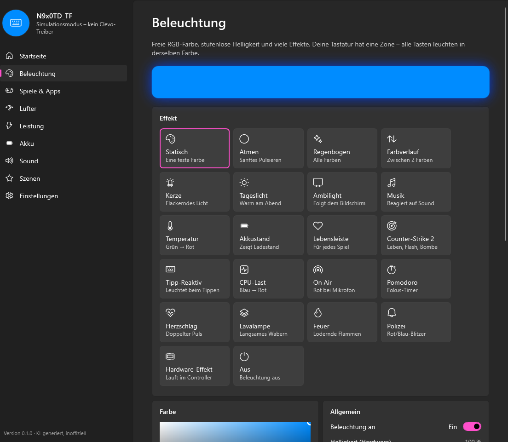

<p align="center">
  
</p>

<h1 align="center">ClevoControl</h1>

<p align="center">
  A modern, open-source control center for Clevo laptops – keyboard RGB, effects, fans, performance profiles and more.<br>
  <a href="#deutsch">🇩🇪 Deutsche Version weiter unten</a>
</p>

> [!IMPORTANT]
> **This software is AI-generated.** The code was written with [Claude](https://claude.ai) (Anthropic) and tested on a Clevo N9x0TD_TF.
> It is an **unofficial** community project and **not affiliated with, endorsed by or supported by Clevo Co.** Use at your own risk – see [License](#license).


## Features

| | |
|---|---|
| **Keyboard lighting** | Free RGB color (color square, hue, RGB sliders, hex), stepless brightness, favorites, white-balance calibration, auto-off when idle |
| **20+ effects** | Static, breathing, rainbow, gradient, candle, fire, lava lamp, heartbeat, police, daylight (warm at night), Pomodoro timer, reactive typing, plus the EC's own hardware effects |
| **Ambient light** | Keyboard follows the colors on your screen while watching movies or series |
| **Music mode** | Reacts to whatever is playing – bass/mid/treble as RGB, pulse or beat-driven hue |
| **Status lights** | CPU/GPU temperature, CPU load, battery level, “On Air” (red while an app uses the microphone) |
| **Games** | Health/mana bar read from the screen for *any* game (no injection, anti-cheat safe), native Counter-Strike 2 Game State Integration (health, flash, fire, bomb) |
| **Other RGB software** | Built-in **OpenRGB SDK server** → Artemis, Aurora and other OpenRGB clients (and their game plugins) can drive the keyboard |
| **Fans** | Live RPM/duty/temperatures, auto / max / **custom fan curve** with a hard-coded safety net |
| **Performance** | Clevo profiles (Quiet, Power saving, Performance, Entertainment), Windows power mode, automatic AC/battery switching, lower refresh rate on battery |
| **More** | Battery health & cycle count, volume / mute / mic mute / output device, Windows-key lock, scenes with hotkeys (Ctrl+Alt+Shift+1…9, opt-in), tray menu, autostart, light & dark mode, German & English |
| **Scripting** | Local HTTP API (127.0.0.1 only) and the `clevoctl` command-line tool |

<p>
  
  
  
  
</p>

## Requirements

* Windows 10/11 (x64) – the UI uses the native Windows 11 Fluent theme
* [.NET 9 Desktop Runtime](https://dotnet.microsoft.com/download/dotnet/9.0) (not needed for the self-contained release build)
* A Clevo-based laptop with the **Clevo Control Center driver** installed (`InsydeDCHU.dll` / “AcpiBridge”, normally installed together with Clevo's Control Center from the Microsoft Store or the vendor's driver page).
  ClevoControl **does not ship** this proprietary DLL – it loads it from the installed driver.
* No administrator rights needed.

Without the driver, the app starts in **simulation mode** so you can still look around.

### Tested hardware

| Model | Keyboard | Status |
|---|---|---|
| Clevo N9x0TD_TF (N950TD/N960TF) | 1-zone RGB | ✅ colors, brightness, sensors, fan modes, performance profiles (fixed in 0.1.1), local API · ⏳ hardware effects still being confirmed |

Other Clevo models using the same InsydeDCHU interface (many sold as Schenker/XMG, Tuxedo, System76, Medion Erazer, Eurocom, PCSpecialist …) will probably work as well. 3-zone keyboards are supported as one color, per-key keyboards are not supported yet.
**Please report your model** in an issue (include the output of `clevoctl dump`).

## Install

1. Download the latest release from the [Releases](../../releases) page and unzip it.
2. Run `ClevoControl.exe`. On first start it adopts the performance profile the laptop is currently using.
3. Optional: *Settings → Start with Windows*.

> Windows SmartScreen may warn because the build is not code-signed. Click *More info → Run anyway*, or build it yourself.

### Build from source

```powershell
git clone <this repository>
cd ClevoControl
dotnet build -c Release
dotnet test
# self-contained single-file build:
dotnet publish src/ClevoControl.App -c Release -r win-x64 --self-contained -p:PublishSingleFile=true -o publish
```

## Safety

* **Custom fan curve:** whatever the curve says, fans run at **≥ 35 % from 70 °C, ≥ 70 % from 80 °C and 100 % from 88 °C**. On implausible sensor values, on sleep and on exit the firmware's automatic control takes over again.
  If the app is killed hard (Task Manager) while a custom curve is active, the last duty stays until reboot or until you select *Automatic* (or run `clevoctl fan auto`).
* Only commands that were verified on real hardware or taken from Clevo's own software are sent to the embedded controller. Unknown EC commands are never probed.
* Screen-based features only read pixels, they never touch game memory.

## Command line

```
clevoctl status
clevoctl color #ff8800
clevoctl brightness 60
clevoctl effect wave
clevoctl fan auto
clevoctl profile quiet
```

## Local API

Enable it under *Games & apps*. It only listens on `127.0.0.1`.

```
curl http://127.0.0.1:3002/status
curl -X POST http://127.0.0.1:3002/color  -d "{\"color\":\"#ff0000\",\"seconds\":3}"
curl -X POST http://127.0.0.1:3002/scene  -d "{\"name\":\"Film\"}"
curl -X POST http://127.0.0.1:3002/effect -d "{\"effect\":\"Spectrum\"}"
```

## How it works

Clevo's driver package installs `InsydeDCHU.dll`, which talks to the embedded controller (EC) through ACPI. ClevoControl loads that DLL at runtime and calls it directly. All command numbers and data formats are documented in [docs/PROTOCOL.md](docs/PROTOCOL.md).

## Not included (on purpose)

* **CPU overclocking / undervolting / power limits** – needs a kernel driver. The popular WinRing0 driver has a known vulnerability and is flagged by Microsoft Defender, so it will not be bundled. See [docs/OVERCLOCKING.md](docs/OVERCLOCKING.md).
* Fake Razer Chroma / Logitech / iCUE SDK DLLs – too invasive. Use the OpenRGB server instead.

## Contributing

Issues and pull requests are welcome – especially reports from other Clevo models. Please keep in mind that the codebase is AI-generated; reviews and refactorings are appreciated.

## License

[MIT](LICENSE). This project is not affiliated with Clevo Co. “Clevo” is a trademark of its respective owner. Counter-Strike is a trademark of Valve Corporation. OpenRGB, Artemis and Aurora are independent projects.

---

<a id="deutsch"></a>

## 🇩🇪 Deutsch

**ClevoControl** ist ein modernes, quelloffenes Control Center für Clevo-Laptops.

> [!IMPORTANT]
> **Diese Software wurde mit KI generiert** (Claude von Anthropic) und auf einem Clevo N9x0TD_TF getestet. Sie ist ein **inoffizielles** Community-Projekt und steht in **keiner Verbindung zu Clevo**. Nutzung auf eigene Gefahr.

**Funktionen:**
* Tastatur: freie RGB-Farbe, stufenlose Helligkeit, Weißabgleich, Favoriten, Aus bei Inaktivität
* Über 20 Effekte, darunter **Ambilight** für Filme und Serien, Musik-Modus, Temperatur-, Akku- und Mikrofon-Anzeige („On Air“), Pomodoro, Tipp-Reaktiv sowie die Hardware-Effekte des Controllers
* Spiele: Lebens- und Manaleiste vom Bildschirm (jedes Spiel, anti-cheat-sicher) und Counter-Strike 2 per offizieller Game State Integration
* **OpenRGB-Server**: Artemis, Aurora & Co. inklusive ihrer Spiel-Plugins steuern die Tastatur
* Lüfter: Live-Werte, Auto, Max oder **eigene Lüfterkurve mit Sicherheitsnetz**
* Leistungsprofile, Windows-Energiemodus, automatischer Wechsel bei Akku oder Netzteil, niedrigere Bildwiederholrate im Akkubetrieb
* Akku-Gesundheit, Sound (Lautstärke, Stummschaltung, Mikrofon, Ausgabegerät), Windows-Taste sperren
* Szenen mit Tastenkürzeln (Strg+Alt+Umschalt+1…9, optional), Tray-Menü, Autostart, Hell- und Dunkelmodus
* Lokale HTTP-Schnittstelle und Kommandozeilen-Tool `clevoctl`

**Voraussetzung:** Der Clevo-Control-Center-Treiber (`InsydeDCHU.dll`) muss installiert sein. Er wird nicht mitgeliefert.

**Sicherheit der Lüfterkurve:** Ab 70 °C laufen die Lüfter mit mindestens 35 %, ab 80 °C mit mindestens 70 % und ab 88 °C immer mit 100 %. Bei Standby, beim Beenden und bei unplausiblen Sensorwerten übernimmt wieder die Firmware.

Fehler und Erfahrungen mit anderen Modellen bitte als Issue melden, gern mit der Ausgabe von `clevoctl dump`.
