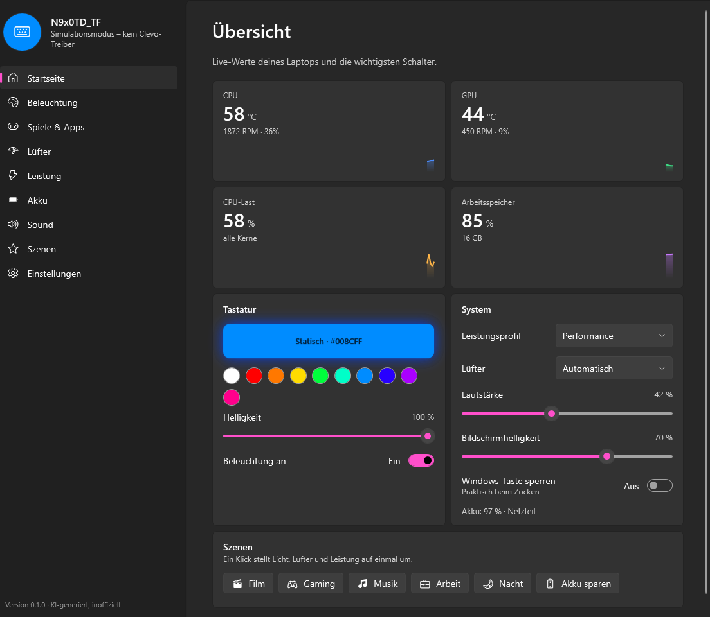
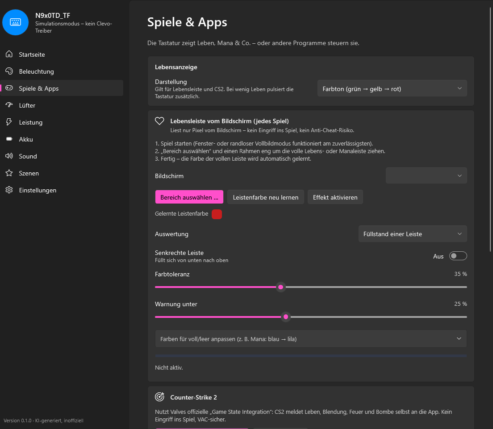
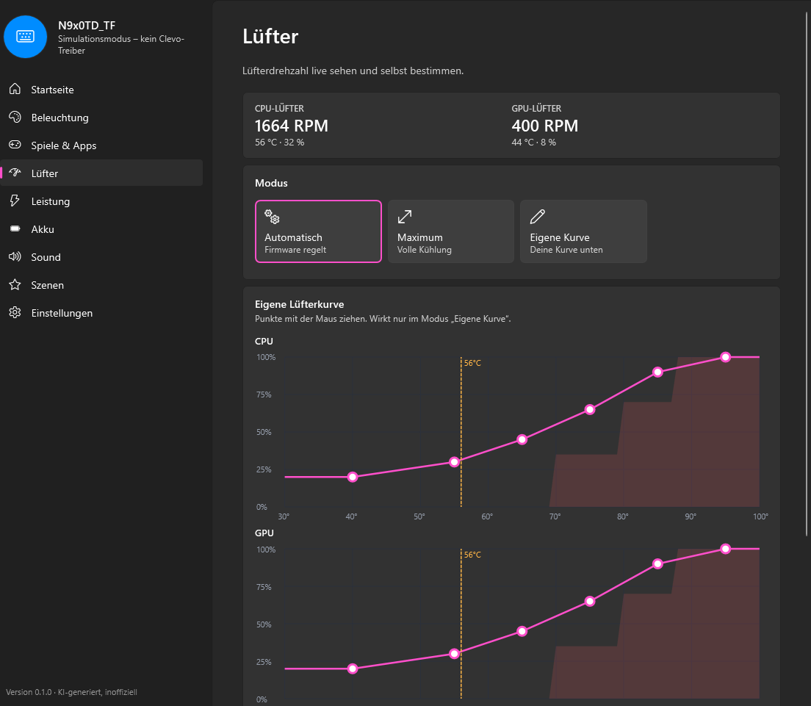
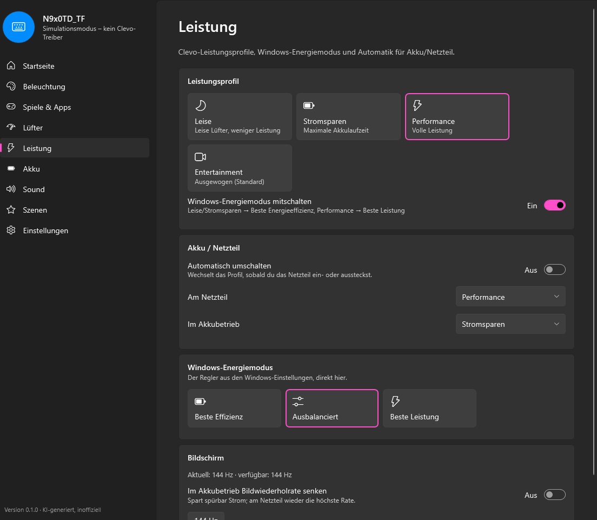
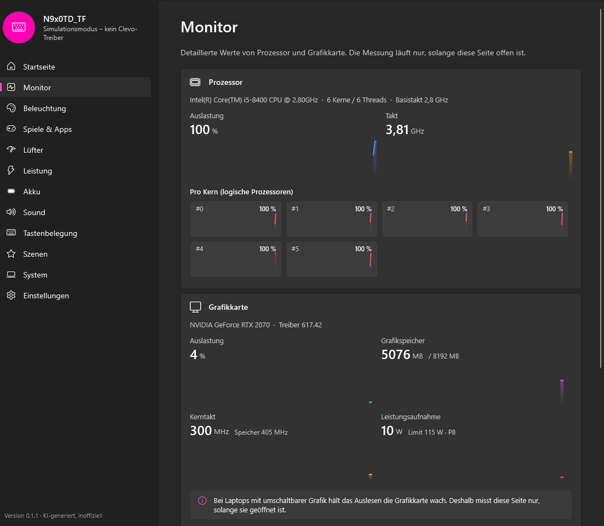

<p align="center">
  
</p>

<h1 align="center">ClevoControl</h1>

<p align="center">
  A modern, open-source control center for Clevo laptops – keyboard RGB, effects, fans, performance profiles and more.<br>
  Windows · Linux (experimental)<br>
  <a href="#supported-models">Supported models</a> ·
  <a href="docs/LINUX.md">Linux</a> ·
  <a href="CONTRIBUTING.md">Contributing</a>
</p>

> [!IMPORTANT]
> **This software is AI-generated.** The code was written with [Claude](https://claude.ai) (Anthropic) and tested on a Clevo N9x0TD_TF.
> It is an **unofficial** community project and **not affiliated with, endorsed by or supported by Clevo Co.** Use at your own risk – see [License](#license).

> [!TIP]
> **Got a Clevo-based laptop?** The quickest way to help is a
> [model report](https://github.com/Jannik99/ClevoControl/issues/new?template=model_report.yml) – it takes two minutes
> and tells everyone whether ClevoControl works on your model.



## Features

| | |
|---|---|
| **Keyboard lighting** | Free RGB color (color square, hue, RGB sliders, hex), stepless brightness, favorites, white-balance calibration, auto-off when idle |
| **20+ effects** | Static, breathing, rainbow, gradient, candle, fire, lava lamp, heartbeat, police, daylight (warm at night), Pomodoro timer, reactive typing, plus the EC's own hardware effects |
| **Ambient light** | Keyboard follows the colors on your screen while watching movies or series |
| **Music mode** | Reacts to whatever is playing – bass/mid/treble as RGB, pulse or beat-driven hue |
| **Status lights** | CPU/GPU temperature, CPU load, battery level, “On Air” (red while an app uses the microphone) |
| **Games** | Health/mana bar read from the screen for *any* game (no injection, anti-cheat safe), native Counter-Strike 2 Game State Integration (health, flash, fire, bomb) |
| **Other RGB software** | Built-in **OpenRGB SDK server** → Artemis, Aurora and other OpenRGB clients (and their game plugins) can drive the keyboard |
| **Fans** | Live RPM/duty/temperatures, auto / max / **custom fan curve** with a hard-coded safety net, fans remembered **per performance profile**, “fans full” hotkey |
| **Per-key RGB** | On keyboards with a per-key controller (detected automatically, experimental): paint every key, per-key rainbow and gradient waves |
| **Monitor** | Detailed graphs: load and clock **per CPU core**, NVIDIA GPU load, VRAM, clocks, power draw (NVML), temperature and fan history |
| **Cooling modes** | Turbo off / CPU limit through the Windows power plan – lowers temperatures **without any driver**, even when the BIOS locks undervolting; overheat notification |
| **Key mapping** | FlexiKey replacement with a clickable keyboard in your real layout (QWERTZ, QWERTY, AZERTY …, detected automatically): map keys to shortcuts, text or programs, or disable them |
| **System** | Model, BIOS, EC firmware, drivers – copied for bug reports with one click; overview of Clevo background software, and switching off its autostart in *Settings* |
| **Battery** | Health, capacity, cycles; **FlexiCharger** charge limit on models that expose it to software (experimental) |
| **Performance** | Clevo profiles (Quiet, Power saving, Performance, Entertainment), Windows power mode, automatic AC/battery switching, lower refresh rate on battery |
| **More** | Volume (in quick settings) / mute / mic mute / output device, Windows-key lock, scenes with hotkeys (Ctrl+Alt+Shift+1…9, opt-in), tray menu, autostart, light & dark mode, German & English |
| **Automation** | Recognises the app in the foreground and switches scenes by itself: **181 known apps** (games, video players, streaming in the browser – Netflix, YouTube, Disney+, Prime Video, Twitch … –, music, meetings) plus **every game** from Steam, Epic, GOG, EA, Ubisoft, Battle.net, Riot and Xbox, Unreal Engine and fullscreen games; restores the previous state afterwards |
| **Quick settings** | Windows 11 style tiles on the home page (keyboard light, profile, fans full, CPU throttling, screen color, Win key, mute, mic …), configurable, plus volume, screen and keyboard brightness |
| **Scripting** | Local HTTP API (127.0.0.1 only) and the `clevoctl` command-line tool |

<p>
  
  
  
  
  
</p>

## Requirements

### Windows

* Windows 10/11 (x64) – the UI uses the native Windows 11 Fluent theme
* [.NET 9 Desktop Runtime](https://dotnet.microsoft.com/download/dotnet/9.0) (not needed for the self-contained release build)
* A Clevo-based laptop with the **Clevo Control Center driver** installed (`InsydeDCHU.dll` / “AcpiBridge”, normally installed together with Clevo's Control Center from the Microsoft Store or the vendor's driver page).
  ClevoControl **does not ship** this proprietary DLL – it loads it from the installed driver.
* No administrator rights needed.

Without the driver, the app starts in **simulation mode** so you can still look around.

### Linux (experimental)

* x86-64 Linux with the open-source [tuxedo-drivers](https://github.com/tuxedocomputers/tuxedo-drivers) kernel modules
* The **ClevoControl desktop app** (same pages as on Windows), the `clevoctl` command-line tool and an optional background service
* X11 and Wayland; a few features depend on the desktop (screen capture, focused-window detection) – see the feature table

See **[docs/LINUX.md](docs/LINUX.md)** for setup, the full feature list and current limitations.

## Supported models

ClevoControl talks to the embedded controller through **Clevo's own firmware interface** (the ACPI device `CLV0001`,
used by Clevo's Windows driver and by the Linux `clevo_acpi`/`clevo_wmi` modules). Whether a laptop is supported
therefore depends on the **board inside**, not on the brand on the lid: Clevo boards are sold by Schenker/XMG,
TUXEDO, Sager, Eurocom, Origin, PCSpecialist, Nexoc and many others – and the same brands also sell laptops from
other manufacturers that will **not** work.

> [!TIP]
> **Not sure?** Run `clevoctl detect`. It checks the firmware interfaces (and on Linux the driver) and tells you
> whether ClevoControl will work. The app shows the same check under *About & support*.

### Reported by users

Models someone actually ran ClevoControl on. ✅ works · ⚠️ partly · ❌ does not work · ❔ not tested yet

| Model (board) | Keyboard | Windows | Linux | Notes |
|---|---|---|---|---|
| Clevo N9x0TD_TF (N950TD, N960TF) | 1-zone RGB | ✅ | ❔ | Development machine. Colors, brightness, sensors, fan modes and curve, performance profiles, local API. Hardware effects not fully confirmed yet. FlexiCharger not available via software (BIOS only). |

**Your model is missing?** Please open a
[model report](https://github.com/Jannik99/ClevoControl/issues/new?template=model_report.yml), even if only
some things work – that is just as useful. Include the output of `clevoctl detect`, `clevoctl sysinfo` and `clevoctl dump`.

### Expected to work (Clevo boards, not tested yet)

These laptops use Clevo boards with the Clevo interface, so they *should* work – but nobody has confirmed it yet.
Reports are very welcome. Sources: [notebookcheck](https://www.notebookcheck.net) reviews, Eurocom, and the board quirks in
[tuxedo-drivers](https://github.com/tuxedocomputers/tuxedo-drivers/blob/main/src/clevo_keyboard.h).

| Sold as | Clevo board | Notes |
|---|---|---|
| XMG Pro 15 (2019) / XMG Pro 17 (2019) | PB51RF-G / PB71RD-G | |
| XMG Pro 15 (2021, Late 2021) / XMG Pro 17 (2021/22) | PC50DS, PC50HS-D / PC70HS | |
| XMG Pro 15 E23 | PD50SND-G | keyboard may be per-key RGB (experimental, see below) |
| XMG Focus 15 / 17 (2021) | NP50HK / NP70HK | |
| XMG Apex 15 (2020), Eurocom Nightsky ARX15 | NH57AF1 | |
| XMG Ultra 17 (2020), Sager NP9670, Origin EON17-X | X170SM-G | keyboard may be per-key RGB (experimental) |
| XMG Ultra 17 E21, Sager NP9672M, Origin EON-X | X170KM-G | per-key RGB (experimental) |
| Nexoc GH7 | NH77DCQ | |
| TUXEDO Aura 14/15 Gen3 | NL45PU2 / NL57PU, NL45AU2 / NL57AU | |
| TUXEDO XP14 | NV4XMB, NV4XME, NV4XMZ | |
| TUXEDO InfinityBook Pro v3 | N13xWU / N14xWU | white keyboard, older generation (DCHU on Windows uncertain) |
| Other Clevo boards: NH5x/NH7x, NP5x/NP7x, NL5x, NS50, PB5x/PB7x, PC5x/PC7x, PD5x/PD7x, PE6x/PE7x, X170, P95x, N24/25BU, L14xMU … | | expected; check with `clevoctl detect` |

### Not supported

| Laptops | Why |
|---|---|
| **TongFang / Uniwill** based models, e.g. XMG Neo 15 (2019) and Neo 16, XMG Core 15, XMG Fusion 15, Eluktronics Mech-15 G3 / MAG-15, Medion Erazer Beast X20/X25/X30 and Major X20, TUXEDO Polaris, Stellaris, Pulse 15 Gen2, InfinityBook Pro Gen7/Gen8 | Different manufacturer and firmware interface (Uniwill). Use TUXEDO Control Center or the vendor's tool. `clevoctl detect` recognises them. |
| **System76** laptops with System76 Open Firmware / open EC (e.g. Darter Pro darp6+, Galago Pro galp5+, Gazelle gaze15+, Lemur Pro lemp9+, Oryx Pro oryp6–oryp12) | Clevo hardware, but the Clevo firmware interface is replaced by System76's own (`system76_acpi`). Expected not to work (not verified). |
| NovaCustom / Dasharo coreboot machines | Same as System76 open EC – probably not supported (not verified). |
| TUXEDO Sirius and other non-Clevo, non-Uniwill TUXEDO lines | Different platform. |
| Eurocom C315 Blitz, Eurocom Raptor X15 | Not the Clevo boards their names suggest – unknown. |

### Known limits

* **Per-key RGB keyboards** (ITE 8291 / 829x USB controller, e.g. X170KM-G) are **experimental**: the app detects the controller and then offers a *Per key* effect
  where you paint each key, plus per-key rainbow and gradient waves. This is built from the tuxedo-drivers and OpenRGB sources
  but has not been tested on real per-key hardware yet – please report how it works. Without a detected controller nothing changes.
* **3-zone keyboards** get one color for all zones in the app (the `clevoctl color <hex> <zone>` command can set zones).
* **Linux on newer CPUs:** the current upstream tuxedo-drivers refuse to load on laptops that are not sold by TUXEDO
  if the CPU is newer than Intel 12th gen (Alder Lake) or a newer Ryzen generation. Such Clevo laptops need a
  build of the drivers without this compatibility check – see [docs/LINUX.md](docs/LINUX.md#1-install-the-kernel-driver).
  Windows is not affected.

## Install

### Windows

1. Download the latest release from the [Releases](../../releases) page and unzip it.
2. Run `ClevoControl.exe`. On first start it adopts the performance profile the laptop is currently using.
3. Optional: *Settings → Start with Windows*.

> Windows SmartScreen may warn because the build is not code-signed. Click *More info → Run anyway*, or build it yourself.

#### Switching from Clevo's Control Center (and back)

You can keep your vendor's Control Center (Clevo, Obsidian, XMG, …) installed and switch back at any time. ClevoControl installs nothing system-wide and doesn't change the other app's settings.

1. **Keep the Control Center installed.** ClevoControl uses the driver that comes with it.
2. **Stop it from running at the same time.** Otherwise both apps fight over fans and lighting.
   - Quit it from its tray icon.
   - Turn off its autostart (*Settings → Apps → Startup*, or *Task Manager → Startup apps*). Turn off *Control Center*, *LED keyboard settings* and *Flexikey* if present.
   - ClevoControl's Home page warns you while one of them is still running.
3. **To go back:**
   - Quit ClevoControl from its tray icon. The fans return to BIOS control.
   - Turn off *Start with Windows* in ClevoControl's settings.
   - Turn the Control Center's autostart back on and start it.
4. **To remove ClevoControl completely:** delete its folder and `%APPDATA%\ClevoControl`.

### Linux

Download `ClevoControl-<version>-linux-x64.tar.gz` from the [Releases](../../releases) page and follow [docs/LINUX.md](docs/LINUX.md).

### Build from source

```powershell
git clone <this repository>
cd ClevoControl
dotnet build -c Release
dotnet test
# self-contained single-file build:
dotnet publish src/ClevoControl.App -c Release -r win-x64 --self-contained -p:PublishSingleFile=true -o publish
```

On Linux (or to build the Linux CLI on Windows): `dotnet publish src/ClevoControl.Cli -c Release -r linux-x64 --self-contained -p:PublishSingleFile=true -o publish`.
More in [CONTRIBUTING.md](CONTRIBUTING.md#building).

## Safety

* **Custom fan curve:** whatever the curve says, fans run at **≥ 35 % from 70 °C, ≥ 70 % from 80 °C and 100 % from 88 °C**. On implausible sensor values, on sleep and on exit the firmware's automatic control takes over again.
  If the app is killed hard (Task Manager) while a custom curve is active, the last duty stays until reboot or until you select *Automatic* (or run `clevoctl fan auto`).
* Only commands that were verified on real hardware or taken from Clevo's own software are sent to the embedded controller. Unknown EC commands are never probed.
* Screen-based features only read pixels, they never touch game memory.

## Command line

```
clevoctl status
clevoctl color #ff8800
clevoctl brightness 60
clevoctl effect wave
clevoctl fan auto
clevoctl profile quiet
```

## Local API

Enable it under *Games & apps*. It only listens on `127.0.0.1`.

```
curl http://127.0.0.1:3002/status
curl -X POST http://127.0.0.1:3002/color  -d "{\"color\":\"#ff0000\",\"seconds\":3}"
curl -X POST http://127.0.0.1:3002/scene  -d "{\"name\":\"Film\"}"
curl -X POST http://127.0.0.1:3002/effect -d "{\"effect\":\"Spectrum\"}"
```

## How it works

On **Windows**, Clevo's driver package installs `InsydeDCHU.dll`, which talks to the embedded controller (EC) through ACPI. ClevoControl loads that DLL at runtime and calls it directly.
On **Linux**, the open-source tuxedo-drivers modules send the same EC commands; ClevoControl uses their `/dev/tuxedo_io` device and the kernel's LED interface.
All command numbers and data formats are documented in [docs/PROTOCOL.md](docs/PROTOCOL.md).

## Not included (on purpose)

* **CPU overclocking / undervolting / power limits** – needs a kernel driver (the driver-free *cooling modes* cover the most common need: lower temperatures). The popular WinRing0 driver has a known vulnerability and is flagged by Microsoft Defender, so it will not be bundled. See [docs/OVERCLOCKING.md](docs/OVERCLOCKING.md).
* Fake Razer Chroma / Logitech / iCUE SDK DLLs – too invasive. Use the OpenRGB server instead.

## Contributing

Contributions are very welcome – you don't need to write code to help:

* **Report your model** – [model report](https://github.com/Jannik99/ClevoControl/issues/new?template=model_report.yml) (works / doesn't work, two minutes)
* **Test on Linux** – the Linux backend has not run on real hardware yet, see [docs/LINUX.md](docs/LINUX.md)
* **Report bugs** – [bug report](https://github.com/Jannik99/ClevoControl/issues/new?template=bug_report.yml)
* **Code** – good first areas are the Linux features marked ❌ in [docs/LINUX.md](docs/LINUX.md#what-works), translations and new lighting effects

Read **[CONTRIBUTING.md](CONTRIBUTING.md)** for how to build, how the code is organised and the safety rules for EC commands.
The codebase is AI-generated; reviews and refactorings are appreciated.

## License

[MIT](LICENSE). This project is not affiliated with Clevo Co. “Clevo” is a trademark of its respective owner. Counter-Strike is a trademark of Valve Corporation. OpenRGB, Artemis and Aurora are independent projects.
